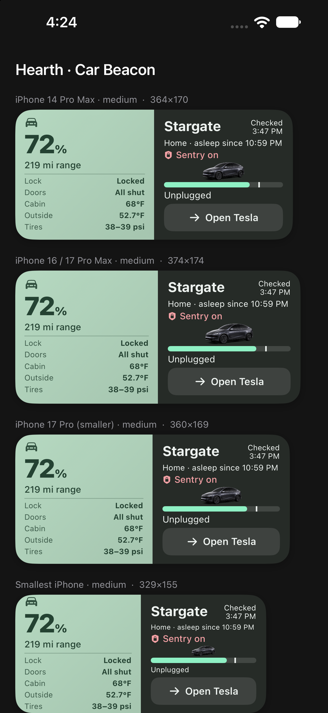
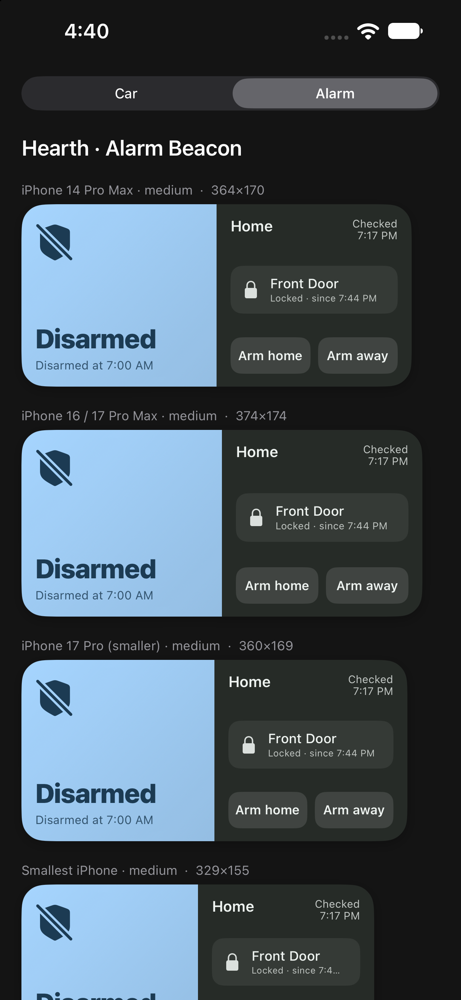
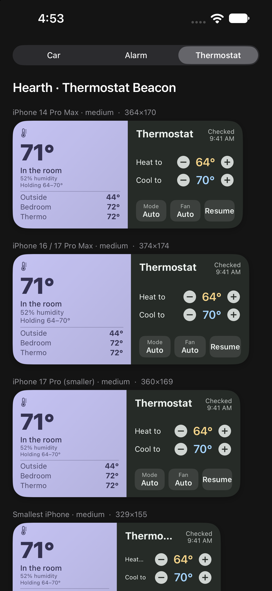
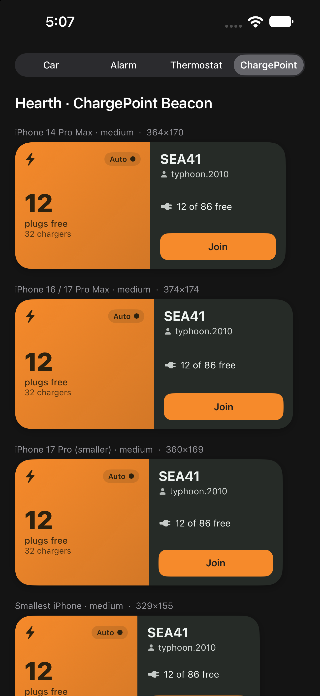

# Hearth for iOS

A native iOS port of [Hearth](https://github.com/rlchandani/hearth) — the Home Assistant
home-screen widgets — rebuilt in Swift / SwiftUI / **WidgetKit** (the Android app is
Kotlin / Jetpack Glance). This is a from-scratch reimplementation, not a mechanical port.

## Structure

| Path | What |
|------|------|
| `HearthKit/` | Local Swift package — **pure, UI-free logic** ported from Android: the Home Assistant client (`HaClient`), the `Car` model + parsing (`carFromTemplate`), and the Car Beacon view-model. Builds + unit-tests on macOS via `swift test` (no Simulator needed). |
| `Hearth/` | The iOS app. For now a **verification gallery** that renders the Car Beacon widget view at each device's medium-widget size. |
| `HearthWidgets/` | The **WidgetKit extension** — the real home-screen widget (`CarWidget`). |
| `Shared/` | SwiftUI views shared by the app + widget (`CarBeaconView`, the Tesla asset). |
| `docs/PORT-SPEC.md` | The exact Android→Swift porting spec (model, template, client, every test case). |
| `docs/PLAN.md` | Scope, status, and what's next. |

## Build

The Xcode project is generated by [XcodeGen](https://github.com/yonaskolb/XcodeGen) from `project.yml`:

```sh
xcodegen generate          # regenerate Hearth.xcodeproj after editing project.yml
open Hearth.xcodeproj       # or build from the command line:
xcodebuild -scheme Hearth -sdk iphonesimulator -destination 'platform=iOS Simulator,name=iPhone 14 Pro Max' build
cd HearthKit && swift test  # run the ported-logic unit tests on macOS
```

## Status

**All four Beacon widgets** are ported and **verified in the iOS Simulator across 14 Pro Max, 16/17 Pro Max,
and the smaller 17 Pro**: **Car** (v1.4.28), **Alarm** (v1.4.26), **Thermostat**, and **ChargePoint** (core
states). All HearthKit logic is unit-tested on macOS — **62 tests** (`swift test`). See `docs/PLAN.md` for
scope and `docs/HA-WIRING.md` for the live-data step (needs your HA URL + token).

## Screenshots

Rendered in the Simulator (the in-app gallery shows each widget at every device's medium-widget size):

| Car | Alarm | Thermostat | ChargePoint |
|-----|-------|------------|-------------|
|  |  |  |  |

## What you'll need to do (needs your hands)

- **Signing** — set your Apple ID / team in Xcode (Signing & Capabilities) to run on a physical iPhone.
  Simulator builds need no signing.
- **Add the widget** — long-press the home screen → add the Hearth widget (can't be automated).
- **Home Assistant config** — the app will store your HA URL + token in an App Group for the widget
  (wiring in progress; the widget currently shows sample data).
